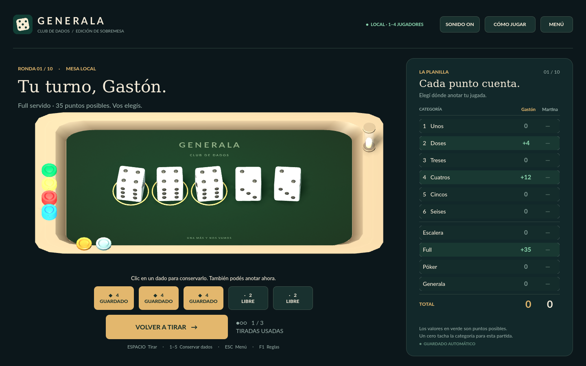

# Generala · Club de dados

[](https://github.com/gstn-caruso/generala/actions/workflows/ci.yml)
[](https://github.com/gstn-caruso/generala/releases/latest)
[](LICENSE)

Juego de Generala 3D en **Godot 4.6 o superior**, con interfaz en español rioplatense y modelos de **KayKit: Board Game Bits**. Dados con física real sobre una bandeja de paño, partidas locales de 1 a 4 personas, planilla interactiva, efectos de sonido y guardado automático. Probado con Godot 4.7.2 en Linux.



## Jugar

Descargá el ZIP de **Linux x86_64** desde [Releases](https://github.com/gstn-caruso/generala/releases/latest), extraelo y ejecutá `generala.x86_64`. No requiere instalar Godot. El ZIP incluye controles, créditos, licencias y versión. Necesita OpenGL 3.3 o superior.

Para comprobar la descarga, colocá el ZIP y `SHA256SUMS.txt` en la misma carpeta y ejecutá:

```bash
sha256sum -c SHA256SUMS.txt
```

Desde el código fuente, en este directorio:

```bash
./jugar.sh
```

El lanzador busca Godot 4.6+ en el sistema. Si no está instalado, descarga la versión oficial 4.7.2 para Linux x86_64, verifica su SHA-256 y la guarda en `~/.local/share/generala/` (o en `$XDG_DATA_HOME/generala/`). Requiere `curl` y Python 3 para esa primera instalación. Después funciona sin conexión.

Para abrir el editor:

```bash
./jugar.sh --editor
```

También podés importar [project.godot](project.godot) desde Godot y presionar **F6** en `scenes/main.tscn`, o **F5** para ejecutar el proyecto. En Windows y macOS, usá esta opción con la versión estándar de Godot, sin .NET. No requiere plugins ni assets externos.

Podés elegir otro ejecutable con `GODOT_BIN=/ruta/a/godot ./jugar.sh`.

## Controles

| Acción | Control |
| --- | --- |
| Tirar o volver a tirar | Botón dorado o **Espacio** |
| Conservar / liberar un dado | Clic sobre el dado 3D, su botón, o teclas **1–5** |
| Anotar y pasar el turno | Clic en una categoría libre de la planilla |
| Abrir o cerrar el menú | **Esc** |
| Ver las reglas | **F1** o **Cómo jugar** |
| Silenciar / activar sonido | **M** o botón de sonido |

Los dados conservados se marcan con un aro dorado. Los valores verdes de la planilla anticipan los puntos posibles. Tachar una categoría con cero requiere confirmación.

## Reglas de esta mesa

Cada jugador tiene hasta tres tiradas por turno. Se puede anotar después de cualquiera de ellas. Cada categoría se usa una sola vez y la partida dura diez rondas. Gana el mayor puntaje; los empates se comparten. El modo solitario permite intentar mejorar el récord local.

| Categoría | Condición | Puntos | En la primera tirada |
| --- | --- | ---: | ---: |
| Unos a seises | Dados del número elegido | Suma de esos dados | Igual |
| Escalera | 1–2–3–4–5 o 2–3–4–5–6 | 20 | 25 |
| Full | Tres iguales y un par diferente | 30 | 35 |
| Póker | Cuatro o cinco iguales | 40 | 45 |
| Generala | Cinco iguales | 50 | Victoria inmediata, si está activada |

La opción **Generala servida gana** se elige antes de empezar. Desactivada, la generala siempre vale 50 puntos. No se incluye doble generala ni escalera circular. Estas variantes quedan explícitas porque las reglas caseras de Generala cambian entre mesas.

El progreso se guarda después de cada tirada, selección y anotación. Al cerrar la ventana durante una tirada se registra la cara superior de cada dado y se consume ese intento. En el inicio aparece **Continuar partida** cuando hay una partida pendiente. Empezar otra requiere confirmar el reemplazo. El guardado es local, en `user://partida.json`; preferencias y récord, en `user://preferencias.cfg`. No necesita una cuenta.

## Estructura

```text
scenes/main.tscn       Escena de entrada
scripts/main.gd       Mesa, interfaz, audio y persistencia
scripts/die.gd        Modelo KayKit, física y detección de caras
scripts/game.gd       Turnos, categorías, jugadores y validación del guardado
scripts/rules.gd      Reglas puras de puntaje
shaders/felt.gdshader  Material de paño procedural
assets/               Tipografías, icono y sonidos originales
assets/kaykit/        Modelos glTF, textura compartida y licencia CC0
tests/                Pruebas de reglas e integración 3D
tools/                Instalador y generador de audio
```

La escena instancia los modelos glTF de KayKit: dados `D6_B`, bandeja `container_B`, fichas de cuatro colores, monedas y reloj de arena. El paño y la interfaz se construyen por código. Los modelos y su textura ya están incluidos en `assets/kaykit/`; no hay descargas adicionales al jugar.

Las caras opuestas de los dados suman siete. La lectura del resultado respeta la orientación original del modelo: −Y=1, +X=2, +Z=3, −Z=4, −X=5, +Y=6. El modelo de 0,75 unidades se escala a una unidad para coincidir con el cuerpo físico. Al detenerse, cada dado se alinea con su cara superior para resolver apoyos en una arista. La tirada tiene un límite de siete segundos para evitar bloqueos de la simulación.

El repositorio incluye los modelos usados y sus dependencias en `assets/kaykit/`. La carpeta original `KayKit_BoardGameBits_1.0_FREE/`, si está presente en el entorno de trabajo, queda fuera de Git y de las exportaciones. Los créditos y la licencia están en [CREDITS.md](CREDITS.md).

## Verificación

```bash
./jugar.sh --headless --script tests/test_game.gd
./jugar.sh --headless --script tests/test_scene.gd -- --test-mode
python3 -m unittest discover -s tools -p 'test_*.py'
```

La primera prueba recorre las **7.776 combinaciones** de cinco dados, comprueba puntajes, bonificaciones, partidas completas de 1–4 jugadores, límites de turno, empates, generala servida y guardados inválidos. La segunda ejecuta la escena y tres tiradas físicas, comprueba dados conservados, lectura de caras, cambios de turno, diálogos y persistencia. El modo de prueba protege las partidas del usuario.

Para regenerar los sonidos originales, sin dependencias adicionales:

```bash
python3 tools/generate_audio.py
```

Las fuentes Lato y DejaVu incluyen sus licencias en `assets/fonts/`. El juego usa el renderizador Compatibility (OpenGL), con ventana mínima de 1152 × 720. Es una partida local por turnos en una sola computadora.

## Build y releases

GitHub Actions verifica títulos de PR, hace una importación limpia, ejecuta las pruebas y exporta un binario Linux con Godot **4.7.2**, fijado y verificado mediante sus checksums oficiales. Antes de empaquetar, inicia el ejecutable exportado con datos de usuario aislados.

Al integrar cambios en `main`, Conventional Commits decide la próxima versión: `feat:` incrementa la menor; `fix:`, `perf:` y `revert:` el parche; `!` o `BREAKING CHANGE:` la mayor. Documentación y mantenimiento no generan una versión por sí solos. La primera es **0.1.0**. Los releases incluyen un ZIP y `SHA256SUMS.txt`; cada PR también deja su build como artifact.

Para repetir el proceso localmente con el instalador de CI:

```bash
python3 tools/install_godot.py
export GODOT="$HOME/.cache/godot-release/4.7.2/godot"
export GODOT_RELEASE_TEMPLATE="$HOME/.cache/godot-release/4.7.2/linux_release.x86_64"
python3 tools/check.py
python3 tools/build_release.py --version 0.1.0
```

Los archivos salen en `build/`, excluido de Git. La configuración de desarrollo se restaura después de exportar. Para contribuir, ver [CONTRIBUTING.md](CONTRIBUTING.md).

## Licencia

El código y los recursos originales del juego usan [MIT](LICENSE). Los modelos KayKit son CC0; el motor y las fuentes mantienen sus propias licencias. Los paquetes incluyen [los avisos completos](THIRD_PARTY_NOTICES.md) y `licenses/`.
